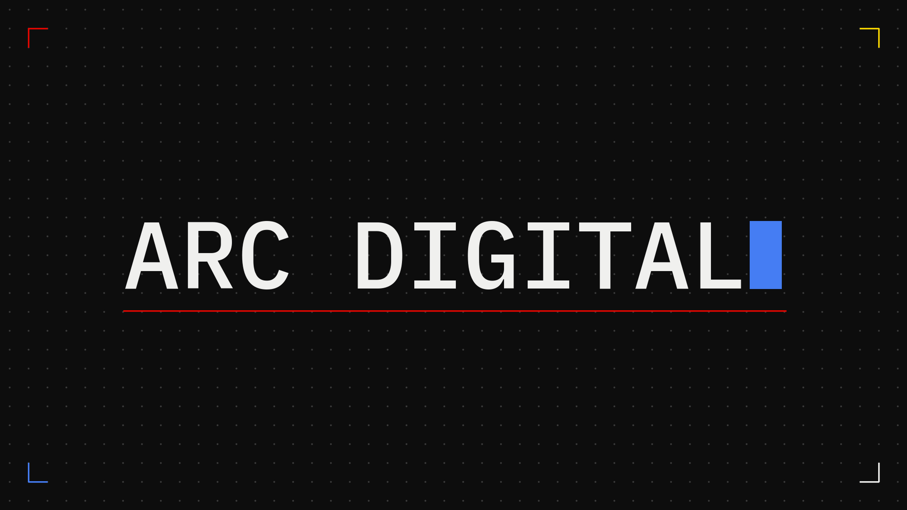

# Arc Blueprint for Omarchy

A dark, blueprint-style [Omarchy](https://omarchy.org/) theme from Arc Digital.
Near-black surfaces, a dot grid, and the Arc palette: red, yellow and blue on warm neutrals.



## Install

```bash
omarchy theme install https://github.com/rymer-software-studios/arc-omarchy-theme.git
omarchy theme set "Arc Blueprint"
```

## Backgrounds

Four backgrounds ship with the theme. Cycle through them with `omarchy theme bg next`.

| File | Description |
| --- | --- |
| `1-omarchy-typed.mp4` | "OMARCHY" typed out with a blinking block cursor, at randomised speeds |
| `2-omarchy.png` | Static "OMARCHY" frame |
| `3-arc-digital-typed.mp4` | "ARC DIGITAL" typed out the same way |
| `4-arc-digital.png` | Static "ARC DIGITAL" frame |

Delete the files you don't want from `backgrounds/` (or from
`~/.config/omarchy/themes/arc-blueprint/backgrounds/` after installing).

## Lock screen

`unlock.png` is the "ARC DIGITAL" wordmark shown on the lock screen; `preview-unlock.png` is a mockup of it.

## Palette

| Role | Hex |
| --- | --- |
| Background | `#111111` |
| Foreground | `#f0f0ee` |
| Accent / blue | `#457df3` |
| Red (selection) | `#e10600` |
| Yellow | `#ffd500` |
| Muted | `#5c5c5c` |

Everything else is in [`colors.toml`](colors.toml). Omarchy generates the terminal, editor
and app configs from it.

## Credits

Backgrounds are set in [IBM Plex Mono](https://github.com/IBM/plex) (SIL Open Font License 1.1).

## License

[MIT](LICENSE)
